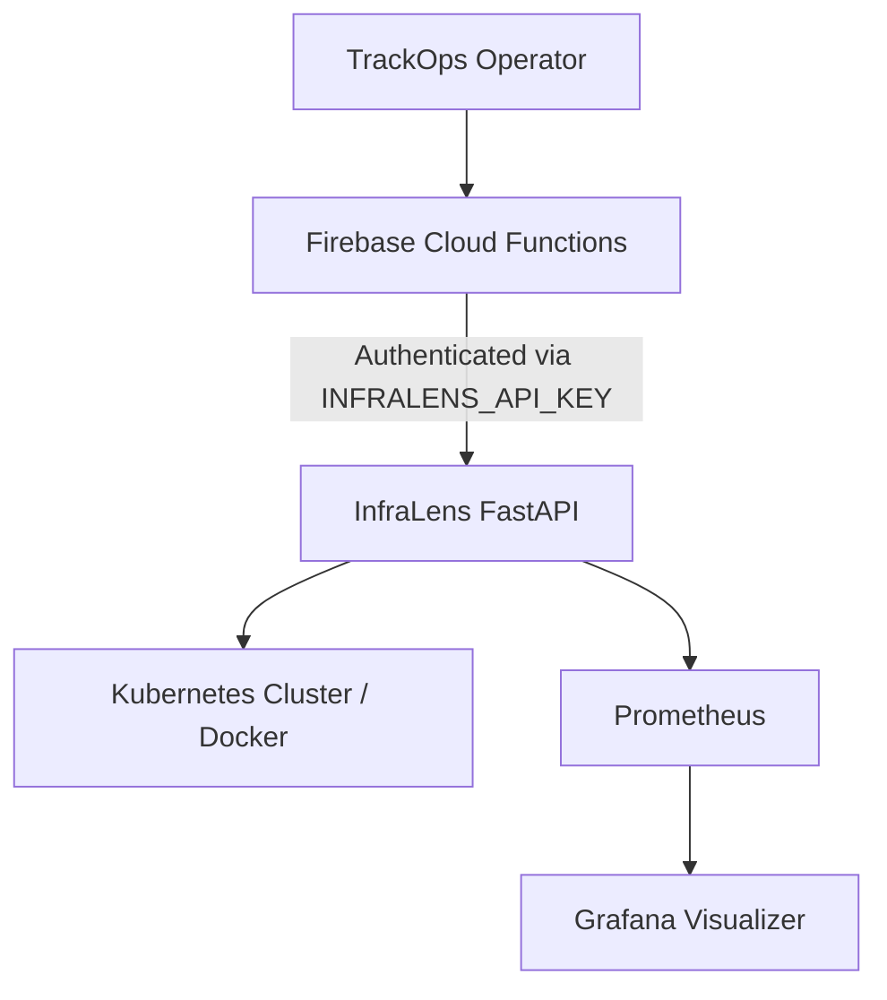

  <h1>🛡️ TrackOps: Mission Control & DevOps</h1>
  
<b>Private Operator System & Infrastructure Monitoring for Trackify V1.0.0</b>

---

## 📌 1. Overview

**TrackOps** is the hidden mission-control system of the Trackify ecosystem. While the main Flutter App and Admin Web dashboard serve construction customers (Contractors and Supervisors), TrackOps is entirely isolated and exists strictly for **internal platform operators**. 

It provides global observability, system health monitoring, DevOps metrics, and AI-driven security/incident triage to ensure maximum uptime across all tenant instances.

---

## 👥 2. Roles & Permissions

TrackOps strictly enforces zero-trust architecture. Customers have zero access to TrackOps.

| Role | Access Level | Capabilities |
|------|--------------|--------------|
| **Super Admin** | Global / Root | Full access to all tenant data, TrackOps dashboard, and infrastructure controls. |
| **TrackOps Operator** | Operator | Access to global monitoring, billing alerts, AI incident triage, and deployment logs (via Vercel). **Cannot** alter customer business logic. |
| **Contractor / Customer** | None | Strictly isolated to their own tenant data via `firestore.rules`. No knowledge of TrackOps. |

---

## 🎛️ 3. The TrackOps Dashboard

The TrackOps dashboard serves as the primary interface for system operators.

### Core Features:
- **System Health & Telemetry:** Real-time metrics streaming from Firebase Cloud Functions and Vercel edge networks.
- **Security & Threat Detection:** Aggregation of App Check failures, unauthorized Firestore read attempts, and suspicious authentication behavior.
- **Billing Alerts:** Automated warnings regarding Firebase read/write spikes and Vercel bandwidth consumption.
- **AI-Driven Incident Triage:** Powered by **Google Gemini Flash**, the system can autonomously analyze stack traces, determine severity, and even trigger `MAINTENANCE_REQUIRED` mode to gracefully degrade services during critical failures.

---

## 🏗️ 4. DevOps & InfraLens Architecture

**InfraLens** is the DevOps and observability stack underpinning TrackOps, deployed privately using container orchestration.

### Stack Components:
- **Compute / Orchestration:** Docker & Kubernetes (Local development via Docker Compose).
- **Backend API:** FastAPI (Python) handles secure, authenticated server-to-server requests from Firebase Cloud Functions.
- **Metrics Collection:** Prometheus and Node Exporter gather hardware and application-level metrics.
- **Visualization:** Grafana dashboards provide deep visual insights into cluster health.

### The Observability Pipeline:

---

## 🚀 5. Deployment & Integration

TrackOps operators maintain the CI/CD pipeline and production deployment environments.

### Vercel Integration (Frontend)
- The Trackify Admin Dashboard is deployed via Vercel.
- TrackOps utilizes the **Vercel API Token** (`VERCEL_TOKEN`) securely stored in Firebase Secret Manager to fetch deployment logs and trigger rollbacks directly from the TrackOps dashboard.

### Firebase Integration (Backend & Mobile)
- TrackOps oversees Firebase Cloud Functions, managing the auto-cleanup of security telemetry (e.g., purging logs older than 90 days).
- Monitors Firebase App Check validation rates to ensure the Flutter applications are secure against spoofing.

---

## 🔐 6. Secrets & Environment Management

TrackOps relies on secure server-to-server communication. The following secrets are strictly managed and **never** exposed to the frontend or version control:

- `VERCEL_TOKEN`: Allows TrackOps to fetch deployment status and logs.
- `INFRALENS_API_KEY`: Ensures only authorized Firebase Functions can query the private Kubernetes cluster.
- `GEMINI_API_KEY`: Authorizes the AI Triage agent to analyze system errors.

---

## 🚨 7. Error Handling & Incident Escalation

TrackOps provides operators with clear protocols for handling production issues:

1. **Detection:** InfraLens or Firebase Cloud Functions detect an anomaly (e.g., sudden spike in 500 errors).
2. **AI Triage:** The Gemini agent analyzes the error logs and categorizes the incident (Low, Medium, Critical).
3. **Automated Response:** If Critical, Gemini can flag the database to enter graceful degradation (Offline mode for users).
4. **Operator Action:** TrackOps Operator investigates via Grafana and Vercel logs to deploy a hotfix.

---

  <i>Part of the Trackify V1.0.0 Architecture • Private & Confidential</i>

